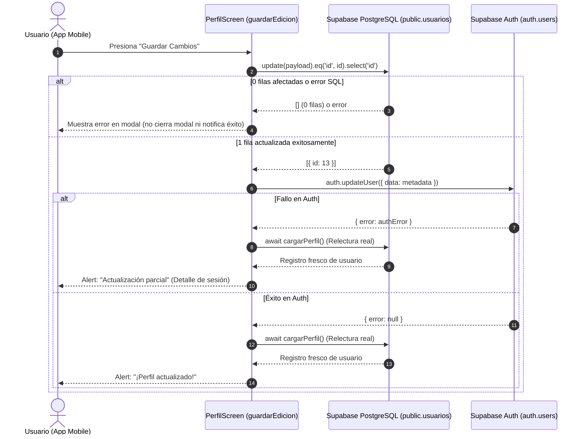

# Documentación Técnica: Persistencia Real al Editar Perfil (S2-T15)

## 1. Identificación y Contexto
- **Tarea:** `S2-T15-Diego Vásquez — Comprobar persistencia real al editar Perfil`
- **Módulo:** `app-mobile` (`src/screens/PerfilScreen.js`)
- **Objetivo:** Fortalecer el resultado de edición de Perfil para que la interfaz no informe éxito cuando la actualización no haya afectado el registro esperado o alguna operación necesaria haya fallado.

---

## 2. Criterios de Aceptación y Solución Implementada

### Criterio 1: Una actualización de cero filas no se informa como éxito
- **Problema previo:** En Supabase / PostgREST, una sentencia `.update(...)` donde el filtro `id` no encuentra filas o es denegado silenciosamente por políticas RLS devuelve `error: null`. Sin solicitar datos de retorno, el cliente interpretaba la respuesta como un éxito falso.
- **Implementación:** Se agregó `.select('id')` a la consulta de actualización. Inmediatamente después se verifica:
  ```javascript
  const { data: updateData, error: updateError } = await supabase
    .from('usuarios')
    .update(payloadConAuth)
    .eq('id', usuarioGuardadoId)
    .select('id');

  if (updateError) throw updateError;

  if (!updateData || updateData.length === 0) {
    throw new Error('No se actualizó ningún registro en la base de datos (0 filas afectadas).');
  }
  ```
  Si se detectan 0 filas afectadas, se lanza una excepción que es interceptada por el bloque `catch (err)`, asignando el mensaje a `setErrorEdit` y manteniendo el modal abierto sin emitir mensaje de éxito.

### Criterio 2: Los errores de Auth son comprobados
- **Problema previo:** `supabase.auth.updateUser()` retorna un objeto `{ data, error }` y no dispara excepciones `throw`. El código anterior envolvía la llamada en un `try { ... } catch` que nunca capturaba el error retornado en `error`, emitiendo únicamente una advertencia en consola.
- **Implementación:** Se captura y comprueba explícitamente el objeto `authError`:
  ```javascript
  let advertenciaAuth = null;
  try {
    const { error: authError } = await supabase.auth.updateUser({
      data: {
        first_name: nombreLimpio,
        last_name: apellidoLimpio,
        full_name: `${nombreLimpio} ${apellidoLimpio}`.trim(),
        telefono: telLimpio || null,
      },
    });

    if (authError) {
      console.warn('[PerfilScreen] Error retornado por auth.updateUser:', authError);
      advertenciaAuth = authError.message || 'Error al sincronizar metadatos de sesión.';
    }
  } catch (authErr) {
    console.warn('[PerfilScreen] Excepción al invocar auth.updateUser:', authErr);
    advertenciaAuth = authErr?.message || 'Fallo de comunicación con el servicio de autenticación.';
  }
  ```

### Criterio 3: Un resultado parcial se comunica correctamente
- **Problema previo:** Si la base de datos se actualizaba pero la capa de autenticación fallaba, el sistema mostraba un mensaje genérico de éxito total, ocultando inconsistencias entre la tabla `usuarios` y la sesión en `auth.users`.
- **Implementación:** Si `advertenciaAuth` contiene un mensaje de error tras persistir en base de datos, se comunica al usuario a través de un diálogo específico de actualización parcial:
  ```javascript
  if (advertenciaAuth) {
    Alert.alert(
      'Actualización parcial',
      `Tus datos fueron guardados en la base de datos, pero hubo un problema al sincronizar la sesión: ${advertenciaAuth}`
    );
  } else {
    Alert.alert(
      '¡Perfil actualizado!',
      'Tus datos personales fueron modificados y persistidos correctamente.'
    );
  }
  ```

### Criterio 4: Recargar Perfil demuestra que el cambio fue persistido
- **Problema previo:** El flujo anterior modificaba el estado de React localmente con `setUsuarioData((prev) => ({ ... }))`, simulando el cambio en memoria sin reconsultar la base de datos.
- **Implementación:** Se invoca de forma asíncrona `await cargarPerfil()`. Esta función realiza la consulta directa a PostgreSQL (`supabase.from('usuarios').select('*, roles(nombre)')...`), comprobando y demostrando que los datos fueron realmente persistidos en el almacenamiento secundario y manteniéndose íntegros ante cualquier recarga posterior de la pantalla.

---

## 3. Diagrama de Flujo del Proceso


