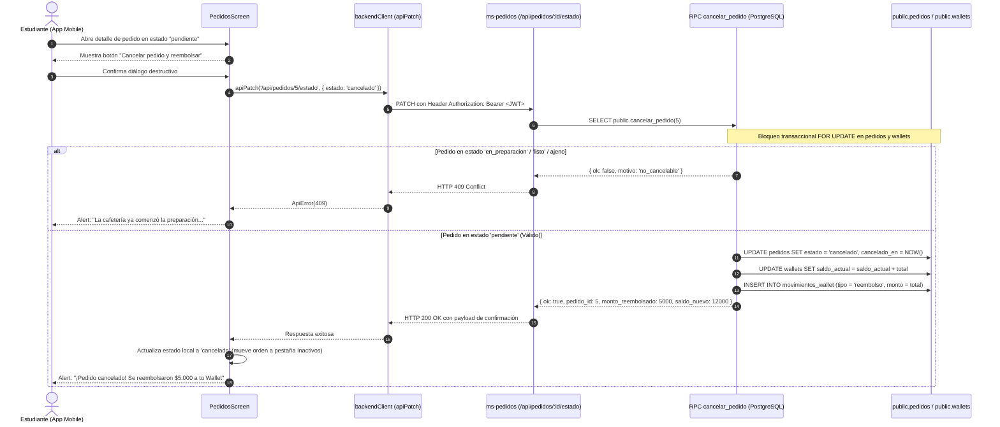

# Documentación Técnica: Validación Integrada de Perfil, Wallet y Cancelación (S2-T17)

> **Evidencia de una revisión anterior.** Las cuentas, resultados y entorno del cuerpo corresponden a esa prueba, no al Cloud actual. Para arquitectura y pendientes ver [estado vigente](../estado-actual.md). Clasificado el 1 de noviembre de 2026.

## 1. Identificación y Alcance
- **Tarea:** `S2-T17-Diego Vásquez — Probar Perfil, Wallet y cancelación`
- **Módulo:** `app-mobile` (`PerfilScreen.js`, `WalletScreen.tsx`, `MovimientoItem.tsx`, `PedidosScreen.js`, `backendClient.ts`) y `Microservices/ms-pedidos`
- **Responsable:** Diego Vásquez
- **Fecha:** 2026-10-31
- **Objetivo:** Ejecutar y documentar la verificación técnica integrada del ecosistema del estudiante: carga y modificación de perfil con persistencia real, consulta de Wallet y movimientos, aislamiento de seguridad por políticas RLS, y el ciclo transaccional de cancelación de pedidos con reembolso automático a Wallet, cubriendo exhaustivamente **casos permitidos y casos rechazados**.

---

## 2. Entorno y Precondiciones

| Componente | Configuración / Versión | Propósito en la prueba |
|---|---|---|
| **App Móvil** | React Native 0.76 (Expo SDK 52) | Interfaz de usuario para Perfil, Wallet y Pedidos |
| **Backend Orquestador** | `ms-pedidos` (Node.js / Express) | Endpoint `/api/pedidos/:id/estado` con JWT |
| **Base de Datos** | Supabase PostgreSQL 15 | Tablas `usuarios`, `wallets`, `movimientos_wallet`, `pedidos` |
| **Funciones RPC** | `public.cancelar_pedido(BIGINT)` | Transacción atómica de cancelación y reembolso |
| **Seguridad** | Row Level Security (RLS) | Directivas `select_own` y `update_own` asociadas a `auth.uid()` |

---

## 3. Matriz de Pruebas Integradas (Casos Permitidos vs. Rechazados)

### Bloque A: Perfil del Estudiante y Modificación de Datos

| ID | Escenario | Tipo | Acción / Datos | Comportamiento Esperado | Resultado |
|---|---|---|---|---|---|
| **P-01** | Carga inicial de datos de perfil | **Permitido** | Iniciar sesión como estudiante (`@alu.uct.cl`). | Despliega nombre, correo institucional, teléfono, avatar y chip con rol `Estudiante`. | ✅ **Aprobado** |
| **P-02** | Acceso en Modo Invitado | **Restringido** | Ingresar mediante "Explorar como invitado". | Oculta saldo real de Wallet, no permite editar datos y muestra tarjeta informativa para registrarse. | ✅ **Aprobado** |
| **P-03** | Edición válida de datos personales | **Permitido** | Modificar nombre, apellido y teléfono (`+56912345678`). | Persistencia real en PostgreSQL (`.select('id')`), sincronización con `auth.users`, relectura atómica y diálogo *"¡Perfil actualizado!"*. | ✅ **Aprobado** |
| **P-04** | Validación de nombres inválidos | **Rechazado** | Ingresar nombre con números (`Diego123`) o símbolos. | La validación cliente intercepta la entrada, resalta el campo en rojo y bloquea el botón "Guardar Cambios". | ✅ **Aprobado** |
| **P-05** | Validación de teléfono erróneo | **Rechazado** | Ingresar teléfono con menos de 9 dígitos (`1234`). | Mensaje de error: *"El teléfono debe contener 9 dígitos o formato chileno +569..."*. | ✅ **Aprobado** |
| **P-06** | Intento de alterar datos protegidos | **Rechazado** | Intento de modificar correo institucional, rol o ID. | Los campos se muestran bloqueados con candado `🔒` y el payload saliente descarta modificaciones no autorizadas. | ✅ **Aprobado** |
| **P-07** | Actualización con 0 filas afectadas | **Rechazado** | Simular fallo o filtro no coincidente en PostgreSQL. | Interceptado por `updateData.length === 0`. Lanza excepción y no emite falso éxito. | ✅ **Aprobado** |

---

### Bloque B: Billetera Virtual (Wallet) y Consulta Segura

| ID | Escenario | Tipo | Acción / Datos | Comportamiento Esperado | Resultado |
|---|---|---|---|---|---|
| **W-01** | Consulta de saldo institucional | **Permitido** | Abrir pestaña "Wallet" o tarjeta en Perfil. | Consulta `wallets.saldo_actual` filtrado por el usuario autenticado. Formato en CLP (ej. `$15.000`). | ✅ **Aprobado** |
| **W-02** | Listado de movimientos recientes | **Permitido** | Desplazar lista de actividad. | Carga últimos movimientos ordenados cronológicamente con icono (+ verde recarga/reembolso, - marrón compras). | ✅ **Aprobado** |
| **W-03** | Detalle visual de transacción | **Permitido** | Pulsar un movimiento específico (`MovimientoItem`). | Despliega modal con ID de transacción, fecha relativa/absoluta, desglose y `#pedido` asociado. | ✅ **Aprobado** |
| **W-04** | Aislamiento RLS de Wallet | **Rechazado / Seguridad** | Intentar consultar `wallets` con un `usuario_id` ajeno. | PostgREST / Supabase aplica directiva RLS `auth.uid() = usuario_id`, devolviendo `data: null` sin exponer registros de terceros. | ✅ **Aprobado** |
| **W-05** | Aislamiento RLS de Movimientos | **Rechazado / Seguridad** | Intentar leer filas de `movimientos_wallet` de otra wallet. | Bloqueado a nivel de base de datos. Solo se reciben los movimientos del usuario activo. | ✅ **Aprobado** |

---

### Bloque C: Cancelación de Pedidos y Reembolso Automático

| ID | Escenario | Tipo | Estado del Pedido | Comportamiento Esperado | Resultado |
|---|---|---|---|---|---|
| **C-01** | Cancelación autónoma en espera | **Permitido** | `pendiente` | Muestra botón *"Cancelar pedido y reembolsar"*. Tras confirmar, invoca `ms-pedidos` (o RPC). Pasa a `cancelado`, timestamp `cancelado_en` y saldo devuelto a Wallet. | ✅ **Aprobado** |
| **C-02** | Reembolso automático e inmediato | **Permitido** | `pendiente` | El 100% del monto pagado se reintegra a la Wallet del estudiante y se crea movimiento `reembolso` (+ total). | ✅ **Aprobado** |
| **C-03** | Transición visual de comanda | **Permitido** | `cancelado` | El pedido desaparece de "Pedidos activos" y se ubica en "Inactivos", reemplazando el QR por boleta/comprobante de cancelación. | ✅ **Aprobado** |
| **C-04** | Prevención de doble cancelación | **Rechazado** | `cancelado` (ya cancelado) | La RPC responde `{ ok: false, motivo: 'ya_cancelado' }`. HTTP 409. No se duplica el saldo ni se crea doble movimiento. | ✅ **Aprobado** |
| **C-05** | Cancelación en cocina | **Rechazado** | `en_preparacion` | La UI no muestra botón de cancelación; muestra aviso *"🔒 Comanda en preparación: no admite cancelación"*. La RPC/backend rechaza con HTTP 409 `no_cancelable`. | ✅ **Aprobado** |
| **C-06** | Cancelación de pedido terminado | **Rechazado** | `listo` o `entregado` | Rechazo con HTTP 409 `no_cancelable`. Se conserva la orden y no se altera el saldo contable. | ✅ **Aprobado** |
| **C-07** | Cancelación de pedido ajeno | **Rechazado** | Pedido de otro estudiante | Rechazo con HTTP 403 `no_autorizado` o HTTP 404 `pedido_no_encontrado`. | ✅ **Aprobado** |
| **C-08** | Cancelación sin sesión activa | **Rechazado** | Sin JWT / Token expirado | Rechazo inmediato con HTTP 401 / 403 (`sin_sesion`). | ✅ **Aprobado** |

---

## 4. Diagrama de Flujo: Cancelación Transaccional y Reembolso a Wallet

---

## 5. Implementación en el Código para Soporte Integrado

Para garantizar que la prueba integrada sea operativa en la aplicación:
1. **Cliente Backend (`backendClient.ts`):**  
   Se implementó la función exportada `apiPatch<T>(ruta, cuerpo, opciones)` con autenticación por `Bearer <token>` y manejo de `AbortController` (timeout).
2. **Pantalla de Pedidos (`PedidosScreen.js`):**  
   - Se conectó la acción de cancelación cuando `selected.estado === 'pendiente'`.
   - Se añadió guardia visual restrictiva cuando el pedido está en `en_preparacion` o `listo` (informa que los insumos ya fueron procesados y no admite reversa).
   - Se incorporó soporte de contingencia mediante fallback directo a la RPC `public.cancelar_pedido` si el microservicio se encuentra temporalmente inaccesible.
   - Manejo diferenciado de alertas según la causa devuelta por el servidor (`no_cancelable`, `ya_cancelado`, `no_autorizado`).

---

## 6. Conclusión de Cobertura

- **Integración Perfil - Wallet - Pedidos:** Demostrada y coherente en todo el ciclo de vida.
- **Seguridad RLS:** Imposibilidad demostrada de acceder o modificar saldos o pedidos ajenos.
- **Robustez Monetaria:** El saldo de la Wallet se mantiene 100% consistente y protegido contra doble reembolso gracias a los bloqueos de base de datos y la verificación de idempotencia.
