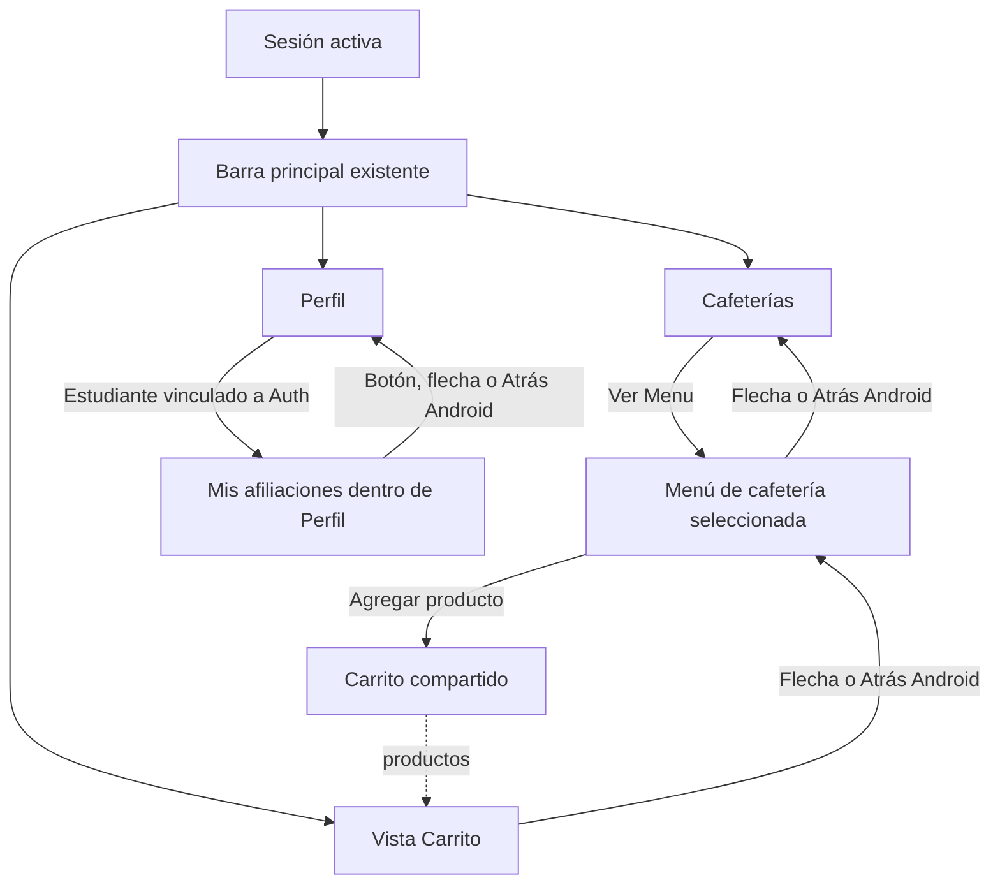

# S3-T1 · Contrato de navegación Mobile

Tarea: `S3-T1-Ariel-Recorrer_Mobile_y_registrar_contrato_de_navegacion`.
Revisión del 17 de noviembre de 2026 sobre `develop` en `111c892`.
La rama incorpora documentación y pruebas; conserva la navegación de aplicación.

## Puntos de entrada y responsables

La navegación vigente se controla con estado de React en
[App.tsx](../../../app-mobile/App.tsx). Aunque el manifiesto incluye React
Navigation, este recorrido no utiliza un `NavigationContainer` ni un stack de
rutas. Hay una sola barra inferior con Cafeterías, Pedidos, Carrito, Wallet y
Perfil. No debe añadirse otro navegador para el acceso de afiliaciones.

| Parte del recorrido | Implementación | Contrato observado |
|---|---|---|
| Listado de cafeterías | [CafeteriaListScreen](../../../app-mobile/src/screens/CafeteriaListScreen.tsx) | Consulta `GET /api/cafeterias` como lectura pública. «Ver Menu» entrega la cafetería elegida a `onSelectCafeteria` |
| Selección de cafetería | `App.handleSelectCafeteria` y `selectedCafeteria` | Guarda el objeto de cafetería y activa `cafeterias`; se muestra su menú |
| Catálogo de productos | [MenuScreen](../../../app-mobile/src/screens/MenuScreen.js) | Recibe `cafeteria`, consulta productos de esa cafetería en Supabase y comunica `onAddToCart(producto, cafeteria)`; `onBack` vuelve al listado |
| Carrito compartido | [CartContext](../../../app-mobile/src/context/CartContext.js) y `App.addToCart` | El proveedor vive sobre las pantallas. Cada producto guarda `cafeteriaId` y `cafeteriaNombre`; `cartCafeteria` se obtiene del primer producto |
| Vista de carrito | [CartScreen](../../../app-mobile/src/screens/CartScreen.js) | Recibe productos y acciones de cantidad, retiro, pago y regreso desde App. Su flecha activa Cafeterías, conservando el menú seleccionado |
| Perfil de la cuenta | [PerfilScreen](../../../app-mobile/src/screens/PerfilScreen.js) | Recibe la sesión de App; contiene el acceso «Mis afiliaciones» y controla su sección interna mediante `afiliacionesUsuario` |
| Destino de afiliaciones | [MisAfiliacionesScreen](../../../app-mobile/src/screens/MisAfiliacionesScreen.js) | Recibe `onBack`; botón, flecha accesible y Atrás de Android regresan al perfil |

Seleccionar o visitar otra cafetería no reemplaza el carrito. Al agregar un
producto de otra cafetería, App solicita confirmación: «Cancelar» conserva el
carrito; «Vaciar y agregar» lo sustituye. La cafetería del pedido se obtiene del
carrito, no del último menú visitado. Cambiar de pestaña conserva la selección
de menú; pulsar Cafeterías cuando ya está activa tampoco vuelve al listado.

## Diagrama del acceso integrado



La flecha desde Carrito regresa al listado si no hay un menú seleccionado.
El diagrama muestra el recorrido con selección previa. Pedidos y Wallet siguen
en la misma barra; se omiten del diagrama para concentrarlo en este acceso.

## Reglas para continuar el módulo

1. **Entrada única:** reutilizar Perfil → Mis afiliaciones. No agregar una sexta
   pestaña, otra instancia de `CartProvider` ni otro contenedor de navegación.
2. **Cuenta:** el acceso requiere sesión, perfil con `auth_user_id` coincidente
   y rol estudiante. No se habilita al invitado, dueño o empleado. El cambio de
   cuenta o el cierre de sesión reinicia la sección del perfil. La visibilidad
   del acceso no sustituye la autorización del servidor.
3. **Contextos distintos:** `selectedCafeteria` identifica el menú visitado;
   `cartCafeteria` identifica el pedido. Una futura selección de campañas no
   debe sobrescribir ninguno de los dos ni vaciar productos por navegar.
4. **Regreso:** la sección consume primero Atrás de Android y llama a `onBack`.
   Desde el perfil, el siguiente Atrás activa Cafeterías; desde su menú, vuelve
   al listado. En la raíz de Cafeterías, App devuelve `false` y deja actuar al
   sistema. El detalle de producto conserva su manejador interno en MenuScreen.
5. **Contratos posteriores:** las consultas y operaciones de afiliados siguen
   [C02](../../contratos-integracion-afiliados.md); T1 no agrega endpoints ni
   modifica el flujo de compra. La base revisada contiene el acceso A01, con
   aviso de disponibilidad futura. Las vistas A02 y la conexión A03 se revisan
   en sus propias ramas y no son parte de la evidencia de esta entrega.

## Evidencia reproducible y alcance

Entorno: Windows, Node.js 22.19.0, React Native 0.76.9, Jest 29.7.0.
Fecha: 17 de noviembre de 2026. Los datos Norte/Sur y la identidad
`t1@example.test` son fixtures ficticios contenidos en la prueba.

La nueva suite [NavegacionMobile.test.js](../../../app-mobile/__tests__/NavegacionMobile.test.js)
monta App, CartProvider, listado de cafeterías, Carrito, Perfil y Mis afiliaciones
reales. Sustituye las respuestas de Auth/Supabase y del gateway, y la pantalla
de menú en su frontera de props. Las acciones del menú se invocan sobre las
props que conecta App: no se acredita su carga de productos ni stock real.
El evento Atrás se reproduce invocando los manejadores registrados en orden
inverso hasta que uno devuelve `true`, con eliminación al desmontar.

| Paso que produce el estado | Resultado comprobado |
|---|---|
| Montar App con sesión simulada | Una barra con las cinco pestañas existentes; listado consultado por su ruta pública |
| Pulsar «Ver Menu» en Norte y agregar un producto mediante la acción del menú | App recibe Norte y Carrito muestra el producto con `cafeteriaId = 7` |
| Abrir Carrito y usar su flecha; pulsar después la pestaña Cafeterías activa | Vuelve al menú de Norte; la pestaña activa no borra la selección |
| Abrir Perfil → Mis afiliaciones después de agregar el producto | Perfil sigue seleccionado, conserva la misma sesión y hay exactamente cinco pestañas |
| Regresar por botón, flecha y Atrás, en tres casos independientes | Se muestra Perfil; al volver a Cafeterías y Carrito se conservan Norte y el producto, sin enviar una compra |
| Visitar Sur y agregar un producto sin confirmar el reemplazo | Se ofrece «Cancelar» / «Vaciar y agregar»; el carrito sigue perteneciendo a Norte |
| Confirmar «Vaciar y agregar» desde el menú de Sur | Carrito contiene únicamente el producto de Sur, con `cafeteriaId = 12` |
| Pulsar Atrás desde Carrito, después desde menú y después desde listado | Menú de Norte → listado → evento sin consumir, respectivamente |

Comandos desde la raíz de esta rama, con las dependencias móviles instaladas:

```powershell
node --version
npm.cmd test --prefix app-mobile -- --ci --runInBand __tests__/NavegacionMobile.test.js
npm.cmd test --prefix app-mobile -- --ci --runInBand
npm.cmd test --prefix app-mobile -- --ci --runInBand --testTimeout=20000
node app-mobile/node_modules/typescript/bin/tsc --noEmit --project app-mobile/tsconfig.json
git diff --check
```

Resultados locales:

- Prueba específica de T1: **6/6 PASS** con el límite predeterminado.
- Suite completa: **93/93 PASS en 14 suites** con `--testTimeout=20000`.
- TypeScript: **PASS**. No se añadieron dependencias ni se modificó el manifiesto.
- Enlaces relativos de los tres documentos tocados: **74 comprobados, sin rotos**.
- `git diff --check`: **PASS**.

Dos ejecuciones completas con el límite predeterminado dieron **92/93**, por
timeout de cinco segundos en la prueba existente de Pedidos «abre inmediatamente
QR completo y token persistidos sin consultar otro servicio». Con 20 segundos,
la misma suite pasó completa. La prueba de Pedidos y la configuración de Jest
se conservaron; no se presenta el comando predeterminado como aprobado en este
entorno. T1 no modifica archivos de aplicación, catálogo, compra ni sesión.

Para reproducirlo manualmente con una cuenta de prueba, iniciar la app según la
[guía móvil](react-native.md), seleccionar una cafetería, agregar un producto,
abrir Carrito y realizar Perfil → Mis afiliaciones → Perfil. Volver a Cafeterías
y Carrito y comprobar que se conservan menú, producto y cuenta. Para comprobar
el reemplazo, agregar un producto de otra cafetería y confirmar «Vaciar y agregar».
No pulsar «Proceder al Pago»: este recorrido no requiere crear pedidos.

Esta entrega acredita integración automatizada y revisión estática, no una
nueva ejecución en emulador ni una sesión Auth real. La prueba manual histórica
de A01 está registrada por separado en su [evidencia](../validacion/A01-CAM-266-Acceso-Mis-Afiliaciones.md).
No se consultaron servicios reales, no se realizaron compras ni se cambiaron
datos productivos. No se incorporan archivos de entorno ni credenciales.
